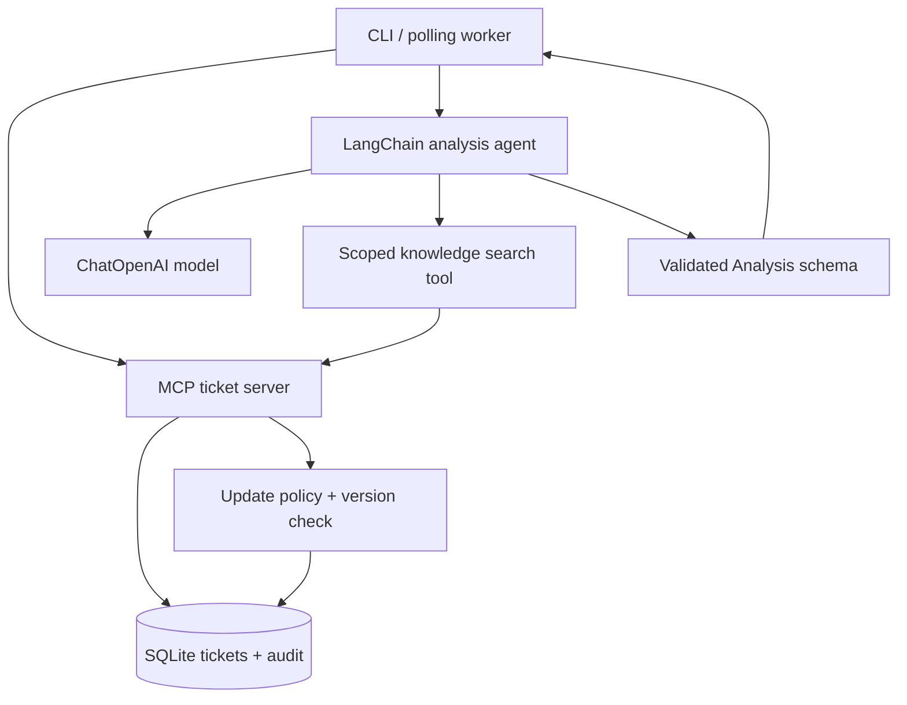

# Ticket analyser and automatic updater — LangChain + MCP

A complete **local reference implementation**: ticket intake, an agent that searches a
knowledge base, structured analysis, automatic internal updates, a polling worker,
human review, and an audit log. Uses Python 3.11+, SQLite, LangChain `create_agent`,
OpenAI through `ChatOpenAI`, and the MCP Python SDK over stdio.

No help-desk account is required for the demo. This is not a deployed Zendesk,
Freshdesk, Jira or ServiceNow integration. The default model is configurable.

## 1. Install and configure

Unzip, open `ticket-agent` in VS Code, and open its terminal:

```bash
python -m venv .venv
# macOS / Linux
source .venv/bin/activate
# Windows PowerShell: .venv\Scripts\Activate.ps1
python -m pip install -r requirements-lock.txt
python -m pip install --no-deps -e .
cp .env.example .env
# Windows PowerShell: Copy-Item .env.example .env
```

Edit `.env`: set `OPENAI_API_KEY` to your own API key. Do not commit this file.
`OPENAI_MODEL=gpt-4o-mini` is the default; select a tool-calling model available to
your account if needed. API use is billed by the provider. Ticket subject/body and
retrieved support guidance are sent to the configured model provider.

The lock file captures the environment used for validation on Python 3.12/Linux;
for another platform if it cannot resolve, install using `python -m pip install -e .`
which uses the compatibility ranges in `pyproject.toml`, then rerun the tests.
The implementation deliberately targets the MCP SDK 1.x maintenance API (`mcp<2`).
It uses an explicit MCP session and a small LangChain tool wrapper, so it does not
need the archived `langchain-mcp-adapters` package.

## 2. Create demo tickets

```bash
ticket-agent init
ticket-agent seed
ticket-agent show 1
```

`seed` adds six fictional tickets each time it is called. On a new database they
receive IDs 1–6: login failure, duplicate billing, outage, account compromise,
ambiguous request, and hostile instruction embedded in a login ticket.

```bash
ticket-agent add --subject "Checkout error" --body "All customers receive a 503 error on checkout."
```

## 3. Preview, then automatically update

```bash
# Calls the model and MCP but does not change tickets:
ticket-agent run --id 1

# Re-analyses and commits one ticket:
ticket-agent run --id 1 --apply

# Process up to 20 eligible tickets:
ticket-agent run --apply --limit 20

# View the saved analysis, draft response and audit snapshots:
ticket-agent show 1
ticket-agent audit 1
```

A preview is not a persisted approval artifact. Running `--apply` performs a fresh
analysis, so wording can differ. `--apply` authorizes internal database changes;
there is no customer-message sending capability in this project.

## 4. Run continuously

```bash
ticket-agent watch --apply --interval 60 --limit 20
```

Keep this terminal running; stop with Ctrl+C. Each cycle finds unprocessed open
tickets and handles them sequentially. A ticket error is isolated from the rest
of the batch. Failed tickets remain eligible and retry on a later cycle; review
cases are removed from automatic processing. Already processed tickets do not
keep generating notes. The polling loop is application code, not an installed OS
service or a ChatGPT automation.

## 5. Human review and customer follow-up

```bash
ticket-agent show 2
# Use the actual current version printed by show:
ticket-agent edit 2 --version 2 --status in_progress
```

After a staff member verifies resolution, use `--status resolved` or `closed` with
the latest version. To trigger analysis after new information, reopen with an
updated body:

```bash
ticket-agent edit 2 --version 3 --status open --body "New customer information goes here."
```

This simple reference stores the latest body rather than a conversation thread;
the audit log preserves previous snapshots. The model never receives the human
edit operation as a tool.

## Architecture



The workflow reads a ticket through MCP and passes only subject, body and priority
to the model. The agent can call `search_knowledge_base` repeatedly. LangChain's
`ToolStrategy(Analysis)` produces a typed result. The workflow, not the model,
chooses the ticket ID and snapshot version and calls MCP `apply_analysis`.

MCP is the protocol boundary between the agent application and ticket operations.
LangChain manages model interaction and tool calling. SQLite stores the tickets;
MCP is neither the database nor the reasoning model.

## What is analysed and updated?

| Field | Behaviour |
|---|---|
| Summary | Short description of the reported problem |
| Category | access, billing, technical, security or other |
| Priority | low, normal, high or urgent; never automatically reduced |
| Sentiment | positive, neutral or negative |
| Evidence | Exact excerpts checked against ticket text |
| Suggested steps | Guidance based on curated support articles |
| KB references | Article IDs checked against the local catalogue |
| Draft reply | Saved internally, never sent |
| Team | Determined by category-to-team mapping in `store.py` |
| Status | `open` or `review_required`; no model-driven resolution/closure |
| Audit | Atomic before/after snapshots for each applied operation |

Automatic review is required for confidence below 0.85, model-requested review,
billing/security categories, invalid evidence excerpts or unknown KB IDs.
Security classification also sets urgent priority and routes to security-response.
These are sample business rules: change `plan()` to fit your help-desk policy.

Model confidence is not calibrated. A model can still misclassify or hallucinate
an answer while giving high confidence. Valid article IDs and exact quotes do not
prove that the recommendation is correct. Prompt instructions reduce risk but do
not guarantee injection resistance. Structural restrictions limit possible actions:
no model access to write tools, arbitrary SQL, arbitrary HTTP, refunds, resets or
message sending. All AI-generated notes and replies must be treated as untrusted.

## Consistency and failure handling

- `BEGIN IMMEDIATE` serializes SQLite writers. Each commit checks the snapshot
  version and eligibility inside the same transaction.
- Idempotency uses ticket ID + source version + policy version. Retrying the same
  applied operation returns its stored result without another write or audit row.
- Ticket and audit writes commit together. A transaction failure rolls both back.
- A concurrent customer/staff edit causes rejection of stale analysis.
- Analysis exceptions and timeouts do not modify the ticket.
- Agent recursion is bounded; provider calls and MCP calls have timeouts.
- The MCP subprocess does not inherit the OpenAI API key.
- Error output contains ticket ID and exception type; inspect locally to diagnose
  without enabling indiscriminate logging of customer text or secrets.

## Code tour / teaching sequence

1. `models.py`: inspect the typed result and allowed values.
2. `store.py`: create and read tickets, then inspect the policy and transaction.
3. `server.py`: see ordinary functions exposed as MCP tools.
4. `agent.py:session`: initialize an MCP client and server subprocess.
5. `agent.py:analyse`: wrap the knowledge search in a LangChain tool; construct
   `create_agent` with structured output and invoke it asynchronously.
6. `agent.py:run_batch`: obtain a snapshot, analyse it, then execute a controlled
   update through MCP. IDs and versions do not come from the model.
7. `cli.py`: add intake and continuous polling around the workflow.
8. `tests/test_system.py`: exercise database correctness and the real MCP boundary.

Example expected *kind* of result for the login ticket (actual model text varies):
`category=access`, `team=access-support`, a reset-email troubleshooting draft, and
`status=open` if the policy permits it. Billing and security require review.

## Tests and validation

```bash
python -m unittest discover -s tests -v
```

The suite does not require an API key. It covers dry runs, idempotency, version
conflicts, review routing, evidence checks, priority preservation, closed-ticket
protection, schema restrictions, human reopening, analysis failure, and real MCP
stdio read/search/write round trips with a deterministic substitute analyser.

All 13 tests passed, including the real LangChain tool-calling and structured-output loop with a scripted model. See `validation.txt`. Live model output and provider credentials are not tested by that suite. Evaluate
on labelled tickets before relying on unattended classification. Suggested measures:
category accuracy/macro-F1, urgent-case recall, incorrect-routing rate, draft factual
accuracy, review rate, cost and latency. Include adversarial and ambiguous tickets.

## Connect an actual ticket platform

Replace the storage adapter behind `server.py` with the selected platform's API:

1. Map remote ticket ID, text, status, priority, group and revision/ETag to the
   snapshot contract. Use a dedicated least-privilege service account.
2. Poll incremental updates or receive authenticated webhooks. Deduplicate by
   platform event ID and durable source revision, not arrival time.
3. Translate the controlled update to the platform's fields and **internal note**
   endpoint. Do not accidentally use a public-reply endpoint.
4. Honour revision/ETag guards, rate limits and retry-after headers. Persist
   idempotency keys and a durable outbox; a remote API update and a local audit
   insert cannot share the SQLite transaction used in this demo.
5. Add tenant/user authorization, secrets management, retention/redaction,
   monitoring, bounded retry/dead-letter handling and a staff review interface.
6. For remote MCP transport, add proper authentication and authorization; do not
   expose this local stdio service as an unauthenticated network server.

SQLite and the local CLI trust the OS user. There is no multi-user access control,
SLA engine, attachment processing, webhook server, web dashboard, production
scheduler or vendor connector in this package. Knowledge search is keyword-based
against four sample articles, not embedding/vector RAG. These boundaries keep the
reference runnable and inspectable; they are extension points for deployment.

## Official references

- LangChain agents: https://reference.langchain.com/python/langchain/agents/factory/create_agent
- Structured output: https://docs.langchain.com/oss/python/langchain/structured-output
- MCP Python SDK 1.x: https://py.sdk.modelcontextprotocol.io/v1/

Dependency snapshot and tests were prepared on 31 October 2026.
